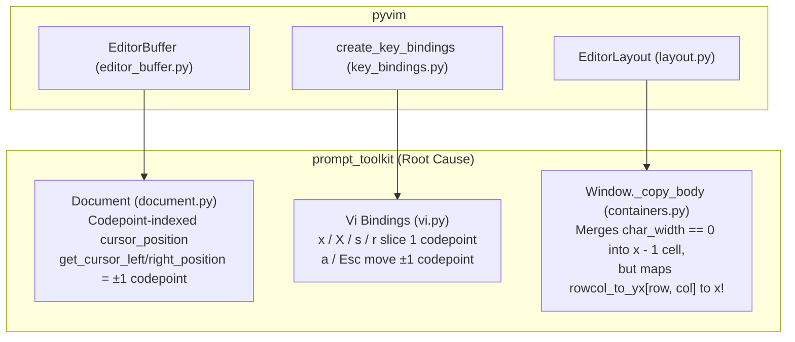

# Thai & Lao Script Support Plan for `pyvim`

This document specifies the root causes of broken Thai/Lao cursor navigation and editing in `pyvim`, and details how to adapt the cell-cluster architecture from `szn` (`src/thai.zig`, `src/grid.zig`, `src/mode_copy.zig`) into `pyvim` with `O(1)` per-keypress overhead[^src-key-bindings][^src-layout].

---

## 1. Problem Statement: Concrete Walkthrough (`"ที่ดิน"`)

In Thai and Lao (Tai) scripts, a single visual character cell consists of a **base character** (width `1`) followed by **0 to 2 zero-width combining marks** (`GC=Mn`, width `0`: upper/lower vowels, tone marks, and cancellation marks).

Consider the Thai word **`"ที่ดิน"`** ("land"), which occupies **3 terminal cells** (`wcswidth("ที่ดิน") == 3`) but consists of **6 Unicode codepoints** (`len("ที่ดิน") == 6`):

| Visual Cell | Screen `x` | Cluster Slice | Codepoint Indices | Codepoints (`U+XXXX`) | Display Widths (`get_cwidth`) |
| :--- | :--- | :--- | :--- | :--- | :--- |
| **Cell 0** (`ที่`) | `x = 0` | `text[0:3]` | `0, 1, 2` | `ท` (`U+0E17`) + `◌ี` (`U+0E35`) + `◌่` (`U+0E48`) | `1, 0, 0` |
| **Cell 1** (`ดิ`) | `x = 1` | `text[3:5]` | `3, 4` | `ด` (`U+0E14`) + `◌ิ` (`U+0E34`) | `1, 0` |
| **Cell 2** (`น`) | `x = 2` | `text[5:6]` | `5` | `น` (`U+0E19`) | `1` |
| **EOL** (` `) | `x = 3` | `text[6:6]` | `6` | *(trailing cursor slot)* | `1` |

### Observed Bugs in Current `pyvim` / `prompt_toolkit`

1. **`h` / `l` requires 6 steps instead of 3**:
   * Pressing `l` from index `0` (`ท`) steps through indices `0 ➔ 1 ➔ 2 ➔ 3 ➔ 4 ➔ 5 ➔ 6` one codepoint at a time instead of jumping across cell boundaries `0 ➔ 3 ➔ 5 (➔ 6)`.
2. **Visual cursor jumps ahead and "sticks" on the next character**:
   * When pressing `l` at index `0` (`ท`), `cursor_position` becomes `1` (`◌ี`), but the terminal cursor immediately jumps to screen column `x = 1` (`ดิ`) and stays stuck on `ดิ` for 3 consecutive presses (`col = 1, 2, 3`) before jumping to `น` on `col = 4`.
3. **`x` / `X` / `s` / `r` corrupts Thai clusters**:
   * Pressing `x` at index `0` (`ที่`) deletes only the base consonant `ท` (`text[0:1]`), leaving orphan combining marks `◌ี` and `◌่` (`text[1:3]`) that attach to whatever character precedes them or render as broken dotted circles.
   * Pressing `rก` at index `0` (`ที่`) overwrites only `ท` with `ก`, producing `"กี่ดิน"` instead of `"กดิน"`.
4. **`a` (append) and `<Esc>` split Thai clusters**:
   * Pressing `a` at index `0` (`ที่`) moves to index `1` (between `ท` and `◌ี`) instead of index `3` (after `ที่`), so newly typed text is inserted inside the vowel/tone stack.
   * Pressing `<Esc>` after typing `"ที่"` moves left by 1 codepoint to index `2` (`◌่`) instead of index `0` (`ท`).

---

## 2. Root-Cause Identification: `prompt_toolkit` vs `pyvim`

The issue originates in **`prompt_toolkit`**, which `pyvim` uses for its `Buffer`, `Document`, `Window` renderer, and Vi key bindings[^src-editor][^src-editor-buffer]:



### Detailed Failure Points in `prompt_toolkit`

| Subsystem | Location in `prompt_toolkit` | Current Behavior | Why It Fails on Thai/Lao |
| :--- | :--- | :--- | :--- |
| **Horizontal Motion** | `Document.get_cursor_left_position` / `get_cursor_right_position` (`document.py:695-711`) | Returns `-min(col, count)` and `min(count, len(after))` in raw codepoints. | Treats zero-width combining marks (`get_cwidth(c) == 0`) as full cursor stops. |
| **Vertical Motion** | `Document.get_cursor_up_position` / `get_cursor_down_position` (`document.py:713-753`) | Uses raw codepoint column `cursor_position_col` as `preferred_column`. | A line with combining marks has a higher codepoint index for the same visual column, causing `j`/`k` to drift horizontally and land mid-cluster. |
| **Single-Char Delete (`x`, `X`, `s`)** | `_delete`, `_delete_before_cursor`, `_substitute` (`vi.py:837-946`) | Calls `buffer.delete(count=event.arg)` (`text_after_cursor[:count]`). | Slices `count` codepoints instead of `count` character cells (`base + comb*`). |
| **Replace (`r`, `R`, `~`)** | `_replace_single`, `_insert_text`, `_reverse_case` (`vi.py:1018-1028, 1903-1918`) | Calls `buffer.insert_text(data, overwrite=True)` which overwrites `len(data)` codepoints. | Overwrites only the base consonant, leaving old combining marks attached to the replacement character. |
| **Visual Selection & Operators** | `Document.selection_ranges` / `selection_range_at_line` (`document.py:904-1002`) | Adds `to += 1` (1 codepoint) for inclusive Vi selections. | Excludes trailing combining marks on the last selected character cell when cutting/yanking/highlighting. |
| **Paste After (`p`)** | `Document.paste_clipboard_data` (`document.py:1056-1071`) | Inserts at `cursor_position + 1` in `VI_AFTER` mode. | Splits the current character cell between its base consonant and its combining marks. |
| **Screen Cursor Mapping** | `Window._copy_body` (`layout/containers.py:2044-2082`) | Increments `x` after the base char (`width = 1`), then processes `char_width == 0` at `x`: writes `new_buffer_row[x + xpos] = char`, merges into `x + xpos - 1`, and records `rowcol_to_yx[lineno, col] = (y + ypos, x + xpos)`. | Maps combining codepoints to the *next* screen column `x` instead of `x - 1`, and leaves a ghost combining mark in `new_buffer_row[x + xpos]` if no character follows. |

---

## 3. Adapting the `szn` Thai Grid Architecture to `pyvim`

### 3.1. How `szn` Models Thai Cells

In `szn` (`src/grid.zig`, `src/thai.zig`, `src/mode_copy.zig`):

1. **Cell-Level Bundling (`Cell`)**:
   * Each grid cell is a `Cell{ .char: u21, .comb1: u13, .comb2: u13, ... }`.
   * When a Thai or Lao combining mark (`isThaiCombining`, `GC=Mn`, width `0`) arrives, `Screen` attaches it to `prev_cell.comb1` or `prev_cell.comb2` without advancing `cursor.x`.
   * Consequently, cursor movements (`moveLeft`, `moveRight`) always step by **1 visual cell** (`base + comb1 + comb2`).
2. **Flat Buffer ↔ Cell Offset Mapping (`lineBytes` / `byteToColumn`)**:
   * When `szn`'s copy mode converts between a flat UTF-8 string and grid cells, each cell `col` records its starting string offset `offsets[col]`, spanning `char + comb1 + comb2`.
3. **Thai/Lao Script Classification (`src/thai.zig`)**:
   * Explicitly classifies Thai (`U+0E00–U+0E7F`) and Lao (`U+0E80–U+0EFF`) combining marks, leading vowels, following vowels, right-attaching marks (`ๆ`, `ฯ`), syllable clusters (`findThaiClusterEnd`), and `libthai` dictionary word boundaries.

### 3.2. Zero-Allocation `O(1)` Cell-Cluster Model for `pyvim`

In `prompt_toolkit`, `Screen` already bundles combining characters into a single `Char` cell (`prev_char.char + c`), while `Document.text` remains a flat Python `str`.

Instead of allocating a cell array on every edit, we enforce the **Cell-Start Invariant**:

> [!IMPORTANT]
> **The Cell-Start Invariant**
>
> 1. A **logical cell** on a line is a slice `line[start:end]` consisting of one base character (`not is_combining_char(line[start])`, or `start == 0`) followed by zero or more combining characters (`is_combining_char(c) == True`).
> 2. In Vi Navigation, Visual, and Operator-Pending modes, `document.cursor_position_col` **must always sit on a cell boundary `start`** (never on an interior combining mark `start < col < end`).
> 3. Every cell-wise motion (`h`, `l`, ` `, `<Left>`, `<Right>`, `a`, `<Esc>`, `$`, `g_`) and cell-wise edit (`x`, `X`, `s`, `r`, `~`, `dl`, `dh`, `v`, `p`) steps or slices from one cell boundary `start` to another cell boundary `end`.

---

## 4. Detailed Design & Algorithms

### 4.1. Phase 1: `pyvim/thai.py` — Thai/Lao Classification & `O(1)` Cell Scanner

Create a new module `pyvim/thai.py` porting the classifications from `szn/src/thai.zig` and providing `O(1)` local scanning functions:

```python
from __future__ import unicode_literals
import unicodedata
from prompt_toolkit.utils import get_cwidth

# Explicit Thai (U+0E00-U+0E7F) and Lao (U+0E80-U+0EFF) combining marks (GC=Mn, width 0)
# Ported directly from szn/src/thai.zig: isThaiCombining()
THAI_LAO_COMBINING_CODES = frozenset([
    # Thai combining marks
    0x0E31,  # MAI HAN-AKAT      ◌ั
    0x0E34,  # SARA I            ◌ิ
    0x0E35,  # SARA II           ◌ี
    0x0E36,  # SARA UE           ◌ึ
    0x0E37,  # SARA UEE          ◌ื
    0x0E38,  # SARA U            ◌ุ
    0x0E39,  # SARA UU           ◌ู
    0x0E3A,  # PHINTHU           ◌ฺ
    0x0E47,  # MAITAIKHU         ◌็
    0x0E48,  # MAI EK            ◌่
    0x0E49,  # MAI THO           ◌้
    0x0E4A,  # MAI TRI           ◌๊
    0x0E4B,  # MAI CHATTAWA      ◌๋
    0x0E4C,  # THANTHAKHAT       ◌์
    0x0E4D,  # NIKHAHIT          ◌ํ
    0x0E4E,  # YAMAKKAN          ◌๎
    # Lao combining marks
    0x0EB1,  # MAI KAN           ◌ັ
    0x0EB4,  # SARA I            ◌ິ
    0x0EB5,  # SARA II           ◌ີ
    0x0EB6,  # SARA Y            ◌ຶ
    0x0EB7,  # SARA YY           ◌ື
    0x0EB8,  # SARA U            ◌ຸ
    0x0EB9,  # SARA UU           ◌ູ
    0x0EBA,  # SIGN PALI VIRAMA  ◌຺
    0x0EBB,  # MAI KON           ◌ົ
    0x0EBC,  # SEMIVOWEL SIGN LO ◌ຼ
    0x0EC7,  # MAITAIKHU         ◌็
    0x0EC8,  # MAI EK            ◌່
    0x0EC9,  # MAI THO           ◌້
    0x0ECA,  # MAI TI            ◌໊
    0x0ECB,  # MAI CATAWA        ◌໋
    0x0ECC,  # CANCELLATION MARK ◌໌
    0x0ECD,  # NIKHAHIT          ◌ໍ
    0x0ECE,  # YAMAKKAN          ◌໎
])


def is_combining_char(ch):
    """
    Return True if `ch` is a zero-width combining character that attaches to
    the preceding base character cell.
    Fast-pathed for ASCII (< 0x0300).
    """
    if not ch:
        return False
    cp = ord(ch)
    if cp < 0x0300:
        return False
    if cp in THAI_LAO_COMBINING_CODES:
        return True
    return get_cwidth(ch) == 0 or unicodedata.category(ch) in ('Mn', 'Me')
```

#### `O(1)` Cell Boundary Helpers

```python
def snap_to_cell_start(line, col):
    """
    Given a codepoint index `col` on `line`, step backward if `line[col]` is a
    combining mark so the returned index always points to the base character.
    """
    line_len = len(line)
    if line_len == 0 or col <= 0:
        return 0
    if col >= line_len:
        return line_len
    if hasattr(line, 'isascii') and line.isascii():
        return col
    while col > 0 and is_combining_char(line[col]):
        col -= 1
    return col


def cell_end(line, col):
    """
    Given a codepoint index `col` on `line`, return the exclusive end index
    of the character cell covering `col` (base char + all trailing combining marks).
    """
    line_len = len(line)
    if col >= line_len:
        return line_len
    if hasattr(line, 'isascii') and line.isascii():
        return col + 1
    pos = col + 1
    while pos < line_len and is_combining_char(line[pos]):
        pos += 1
    return pos


def step_cell_right(line, col, count=1):
    """
    Return the relative codepoint delta to move `count` cells to the right on `line`.
    For "ที่ดิน" (len=6):
      col=0, count=1 -> +3 (lands on 'ด' at 3)
      col=3, count=1 -> +2 (lands on 'น' at 5)
      col=5, count=1 -> +1 (lands on EOL at 6)
    """
    line_len = len(line)
    if count <= 0 or col >= line_len:
        return 0
    if hasattr(line, 'isascii') and line.isascii():
        return min(count, line_len - col)

    pos = col
    for _ in range(count):
        if pos >= line_len:
            break
        pos = cell_end(line, pos)
    return pos - col


def step_cell_left(line, col, count=1):
    """
    Return the relative codepoint delta (<= 0) to move `count` cells to the left on `line`.
    For "ที่ดิน" (len=6):
      col=6, count=1 -> -1 (lands on 'น' at 5)
      col=5, count=1 -> -2 (lands on 'ด' at 3)
      col=3, count=1 -> -3 (lands on 'ท' at 0)
    If `col` is currently inside a cluster (e.g. col=1 or 2 on "ที่"), the first
    step snaps back to the base character (col=0).
    """
    if count <= 0 or col <= 0:
        return 0
    if hasattr(line, 'isascii') and line.isascii():
        return -min(col, count)

    pos = min(col, len(line))
    for _ in range(count):
        if pos <= 0:
            break
        pos -= 1
        while pos > 0 and is_combining_char(line[pos]):
            pos -= 1
    return pos - col
```

#### Trace on `"ที่ดิน"` (`['ท', 'ี', '่', 'ด', 'ิ', 'น']`)

* **Moving Right (`l`) from `col = 0`**:
  * 1st `l`: `0 + step_cell_right("ที่ดิน", 0, 1)` $\rightarrow$ `0 + 3 = 3` (`ดิ`)
  * 2nd `l`: `3 + step_cell_right("ที่ดิน", 3, 1)` $\rightarrow$ `3 + 2 = 5` (`น`)
  * 3rd `l`: `5 + step_cell_right("ที่ดิน", 5, 1)` $\rightarrow$ `5 + 1 = 6` (EOL)
  * **Total presses**: **3** (matching the 3 visual cells).
* **Moving Left (`h`) from `col = 5` (`น`)**:
  * 1st `h`: `5 + step_cell_left("ที่ดิน", 5, 1)` $\rightarrow$ `5 - 2 = 3` (`ดิ`)
  * 2nd `h`: `3 + step_cell_left("ที่ดิน", 3, 1)` $\rightarrow$ `3 - 3 = 0` (`ที่`)

---

### 4.2. Phase 2: `Document` & `Buffer` Cell-Cluster Integration

Because `prompt_toolkit` instantiates `Document` directly inside `Buffer` methods (`Buffer.insert_text`, `Buffer.delete_before_cursor`, `Buffer.undo`, `TextObject.cut`), patching or overriding methods on `Document` (and `Buffer`) ensures **every** caller in both `prompt_toolkit` and `pyvim` inherits cell-cluster semantics automatically[^src-editor-buffer]:

| Method | Current Implementation | New Cell-Aware Behavior |
| :--- | :--- | :--- |
| `Document.get_cursor_left_position(count=1)` | `-min(self.cursor_position_col, count)` | `step_cell_left(self.current_line, self.cursor_position_col, count)` |
| `Document.get_cursor_right_position(count=1)` | `min(count, len(self.current_line_after_cursor))` | `step_cell_right(self.current_line, self.cursor_position_col, count)` |
| `Document.last_non_blank_of_current_line_position()` | `len(self.current_line.rstrip()) - col - 1` | Snaps the last non-blank index via `snap_to_cell_start` so `g_` lands on `'พ'` in `"พี่"`, not `'่'`. |
| `Document.get_cursor_up_position(count, preferred_column)` | Uses codepoint `preferred_column` directly. | Converts `preferred_column` through visual display width (`col_to_visual_x` $\rightarrow$ `visual_x_to_col`) and snaps via `snap_to_cell_start` on the target line. |
| `Document.get_cursor_down_position(count, preferred_column)` | Uses codepoint `preferred_column` directly. | Same visual-column mapping + `snap_to_cell_start` on the target line. |
| `Document.selection_ranges()` & `selection_range_at_line(row)` | `if vi_mode(): to += 1` | `if vi_mode(): to = cell_end_in_text(self.text, to)` so Visual mode (`v`) and `TextObject.cut()` include all combining marks of the final selected cell. |
| `Document.paste_clipboard_data(data, paste_mode, count)` | `VI_AFTER` inserts at `cursor_position + 1`, `VI_BEFORE` decrements cursor by `1`. | `VI_AFTER` inserts at `cursor_position + get_cursor_right_position(1)` (after the full cell), and places the cursor on the base character of the last pasted cell (`snap_to_cell_start`). |

> [!TIP]
> **Automatic Operator Coverage (`dl`, `dh`, `cl`, `ch`, `yl`, `yh`, `a`, `<Esc>`)**
>
> In `prompt_toolkit/key_binding/bindings/vi.py`, `h`, `l`, `<Left>`, `<Right>`, `<Space>`, `<BS>` (in normal mode), `a`, and `<Escape>` all call `document.get_cursor_left_position()` or `document.get_cursor_right_position()`. Updating those two `Document` methods automatically fixes `h`, `l`, `dh`, `dl`, `ch`, `cl`, `yh`, `yl`, `a`, and `<Escape>` in one place!

---

### 4.3. Phase 3: Vi Editing Key Bindings (`pyvim/key_bindings.py`)

In `pyvim/key_bindings.py`, we add/override the Vi editing bindings that currently slice raw codepoint counts in `prompt_toolkit/key_binding/bindings/vi.py`[^src-key-bindings]:

1. **`x` (Delete cell under cursor in Normal mode)**:
   ```python
   @kb.add('x', filter=in_navigation_mode)
   def delete_cell(event):
       buff = event.current_buffer
       count = buff.document.get_cursor_right_position(count=event.arg)
       if count > 0:
           text = buff.delete(count=count)
           event.app.clipboard.set_text(text)
   ```
   * On `"ที่ดิน"` at index `0`: `x` computes `count = 3`, deletes `"ที่"`, copies `"ที่"` to clipboard, and leaves `"ดิน"` with cursor at `0` (`ดิ`).
   * `3x` on `"ที่ดิน"` computes `count = 6` and deletes the entire `"ที่ดิน"`.

2. **`X` (Delete cell before cursor in Normal mode)**:
   ```python
   @kb.add('X', filter=in_navigation_mode)
   def delete_cell_before_cursor(event):
       buff = event.current_buffer
       count = -buff.document.get_cursor_left_position(count=event.arg)
       if count > 0:
           text = buff.delete_before_cursor(count=count)
           event.app.clipboard.set_text(text)
   ```

3. **`s` (Substitute cell under cursor in Normal mode)**:
   ```python
   @kb.add('s', filter=in_navigation_mode)
   def substitute_cell(event):
       buff = event.current_buffer
       count = buff.document.get_cursor_right_position(count=event.arg)
       text = buff.delete(count=count)
       event.app.clipboard.set_text(text)
       event.app.vi_state.input_mode = InputMode.INSERT
   ```

4. **`r` (Replace single cell in Normal mode)**:
   * In `prompt_toolkit`, `r` enters `InputMode.REPLACE_SINGLE`, where the next key calls `insert_text(event.data, overwrite=True)` (which only overwrites `1` codepoint) and `cursor_position -= 1`.
   * We override `Keys.Any` with `filter=vi_replace_single_mode` so that replacing a cell deletes the entire current cell (`count = buff.document.get_cursor_right_position(count=1)`), inserts the replacement character, and positions the cursor on the new base character via `get_cursor_left_position(1)`.

5. **`$` (End of line in Normal mode)**:
   * In `prompt_toolkit`, `$` moves to `get_end_of_line_position()` (or when at EOL, stays at `len(line)`). When `d$` or `c$` is used, it should still delete to the very end of the line (`len(current_line_after_cursor)`), while in Normal mode moving to the last character of `"พี่"` must never leave the cursor on the combining mark `'่'`.

6. **Insert Mode `<Backspace>` vs `<Delete>`**:
   * **`<Backspace>` in Insert mode**: Kept as **1 codepoint deletion** (`delete_before_cursor(1)`). This matches standard Thai IME ergonomics: if a user types `ท` + `◌ี` + `◌้` (`"ที้"`) and wants `"ที่"`, pressing `<Backspace>` removes only `◌้` so they can type `◌่` without retyping `ท` + `◌ี`.
   * **`<Delete>` in Insert mode**: Deletes the full cell ahead of the cursor (`get_cursor_right_position(1)`).

---

### 4.4. Phase 4: Fixing `Window._copy_body` Screen Coordinate Mapping

In `prompt_toolkit/layout/containers.py` (`Window._copy_body`, lines 2044–2082)[^src-layout]:

```python
# Current buggy prompt_toolkit logic when char_width == 0:
new_buffer_row[x + xpos] = char  # BUG 1: Writes zero-width char into NEXT cell x!
if char_width > 1:
    ...
elif char_width == 0:
    for pw in [2, 1]:
        if x - pw >= 0 and new_buffer_row[x + xpos - pw].width == pw:
            prev_char = new_buffer_row[x + xpos - pw]
            char2 = _CHAR_CACHE[prev_char.char + c, prev_char.style]
            new_buffer_row[x + xpos - pw] = char2
current_rowcol_to_yx[lineno, col + skipped] = (
    y + ypos,
    x + xpos,  # BUG 2: Maps combining mark col to NEXT cell x instead of x - pw!
)
```

Why this matters even when Navigation mode snaps to base characters:
* If a line ends with a combining mark and no character follows (or in Insert mode / Visual selection / search highlighting), `BUG 1` temporarily writes the combining mark into `new_buffer_row[x + xpos]`, and `BUG 2` maps `col` to `x + xpos` instead of the base cell `x + xpos - pw`.
* Furthermore, in `layout.py` and `prompt_toolkit/layout/processors.py`, processors that call `explode_text_fragments` (such as `ReportingProcessor` in `pyvim/layout.py:640` and `HighlightSelectionProcessor`) split strings into 1-codepoint fragments.
* By fixing the zero-width branch in `_copy_body` so `char_width == 0` merges directly into `x + xpos - pw` **without** clobbering `new_buffer_row[x + xpos]` and records `current_rowcol_to_yx[lineno, col + skipped] = (y + ypos, x + xpos - pw)`, screen coordinates are 100% consistent for every codepoint in a Thai cluster.

---

### 4.5. Phase 5 (Optional): Thai Word Motions (`w`, `b`, `e`) via `szn`'s Two-Tier Breaker

In `prompt_toolkit/document.py`, Vi word motions (`w`, `b`, `e`, `iw`, `aw`) use regexes:
```python
_FIND_WORD_RE = re.compile(r"([a-zA-Z0-9_]+|[^a-zA-Z0-9_\s]+)")
```
Because Thai characters match `[^a-zA-Z0-9_\s]+` and Thai sentences do not use spaces between words, pressing `w` or `dw` jumps across or deletes an **entire Thai paragraph** at once!

We can port `szn`'s two-tier Thai word/cluster segmentation from `szn/src/thai.zig`:
1. **Tier 1 (`libthai` via `ctypes`)**:
   * Load `libthai.dylib` / `libthai.so` lazily (using the exact search path list from `szn/src/thai.zig:713-730`: `/opt/homebrew/lib/libthai.dylib`, `/usr/local/lib/libthai.dylib`, `/usr/lib/libthai.so.0`, etc.) and call `th_brk_wc_find_breaks` to find dictionary word boundaries in Thai runs.
2. **Tier 2 (Fallback `find_thai_cluster_end` from `szn/src/thai.zig:285-326`)**:
   * If `libthai` is not installed on the system, fall back to syllable/cluster segmentation (`[Leading Vowel]? + Base + [รร]? + [Following Vowels]* + [Right-Attaching Marks]*`) so `w`, `b`, `e` step by Thai syllable clusters instead of jumping over the whole line.

---

## 5. Performance Analysis

A critical requirement is ensuring zero perceptible latency in Python 3.15:

| Operation | ASCII Line (`line.isascii() == True`) | Thai/Lao Line (`"ที่ดิน..."`) | Memory Allocations |
| :--- | :--- | :--- | :--- |
| **`h` / `l` (`count=1`)** | `O(1)` — 1 C bitfield check (`~15 ns`), returns `±1` | `O(1)` — inspects `1–3` codepoints (`~120 ns`) | `0` |
| **`x` / `X` / `s` (`count=1`)** | `O(1)` — slices 1 char | `O(1)` — inspects `1–3` codepoints, slices 1 cell | `0` extra (standard `Document` update) |
| **`j` / `k` (Up / Down)** | `O(1)` — both lines ASCII, direct index | `O(col)` — scans up to current column on 2 lines (`~2–5 µs` for 80 cols) | `0` |
| **Insert Mode Typing** | `O(1)` — unchanged | `O(1)` — unchanged | `0` |

* **Why `str.isascii()` is free in CPython**: Since PEP 393, every Python `str` caches its `ascii` flag in the `PyASCIIObject` C struct header. `line.isascii()` is a single C bitfield read with no character loop.

---

## 6. Implementation & File Touch Map

| File | Action | Responsibility |
| :--- | :--- | :--- |
| `pyvim/thai.py` | **Create** | Thai/Lao codepoint classifications (ported from `szn/src/thai.zig`), `is_combining_char`, `snap_to_cell_start`, `cell_end`, `step_cell_left`, `step_cell_right`, visual column converters, and optional `libthai` / cluster word-break helpers. |
| `pyvim/editor.py` | **Update** | Install the cell-cluster `Document` / `Window._copy_body` patches at `Editor` initialization[^src-editor]. |
| `pyvim/key_bindings.py` | **Update** | Override `x`, `X`, `s`, `r` (`vi_replace_single_mode`), `~`, and `<Delete>` in `in_navigation_mode` / `in_insert_mode` to operate on full character cells[^src-key-bindings]. |
| `tests/test_thai.py` | **Create** | Unit and integration tests covering Thai & Lao cursor navigation and editing on Python 3.15. |

---

## 7. Verification & Test Matrix (`tests/test_thai.py`)

1. **Horizontal Navigation (`h` / `l` / `0` / `$` / `g_`)**:
   * On `"ที่ดิน"` (`len == 6`), starting at index `0`:
     * Pressing `l` moves `0 ➔ 3 ➔ 5` (and `6` at EOL) — **3 steps total**.
     * Pressing `h` from `5` moves `5 ➔ 3 ➔ 0` — **2 steps** (or **3 steps** from `6`).
   * On `"ผู้ใหญ่"` (`ผ`+`◌ู`+`◌้` | `ใ` | `ห` | `ญ`+`◌่`, `7` codepoints, `4` cells), cell stops are `[0, 3, 4, 5]`.
   * On Lao `"ເກາະ"` and `"สบายดี"` (`ส` | `บ` | `า` | `ย` | `ด`+`◌ี`), cell stops skip `◌ี`.
2. **Cell Deletion (`x`, `X`, `dl`, `dh`, `s`)**:
   * Pressing `x` at index `0` on `"ที่ดิน"` produces `"ดิน"` (deletes all 3 codepoints `ท`, `◌ี`, `◌่`), and yanks `"ที่"` into the clipboard.
   * Pressing `x` 3 times on `"ที่ดิน"` produces `""`.
   * Pressing `X` at index `3` (`ดิ`) on `"ที่ดิน"` deletes `"ที่"` and leaves `"ดิน"` with cursor at `0`.
   * `2x` on `"ที่ดิน"` deletes `"ที่ดิ"` (`5` codepoints) and leaves `"น"`.
3. **Single-Cell Replace (`r`)**:
   * Pressing `rก` at index `0` on `"ที่ดิน"` replaces the entire `"ที่"` cell with `"ก"`, producing `"กดิน"` with cursor at `0`.
4. **Append & Escape (`a`, `<Esc>`)**:
   * Pressing `a` at index `0` on `"ที่ดิน"` places the cursor at index `3` (after `"ที่"`, before `"ดิ"`).
   * Typing `"ที่"` in Insert mode and pressing `<Esc>` places the cursor at index `0` (`ท`), not index `2` (`◌่`).
5. **Insert Mode `<Backspace>` Preservation**:
   * In Insert mode after `"ที่"` (cursor at `3`), pressing `<Backspace>` once deletes only `'่'` (leaving `"ที"` at index `2`), allowing immediate correction of tone marks.
6. **Visual Mode (`v`) & Paste (`p` / `P`)**:
   * Pressing `vx` on `"ที่"` cuts all of `"ที่"`, and pressing `p` on `"ดิ"` pastes `"ที่"` after `"ดิ"` (producing `"ดิที่น"`), never splitting `'ด'` and `'◌ิ'`.
7. **Vertical Navigation (`j` / `k`)**:
   * Moving `j` / `k` between `"ที่ดินabc"` and `"123abc"` keeps `'a'` aligned with `'a'` (visual column `3`) and never lands on an interior combining mark.

---

[^src-editor]: [`pyvim/editor.py`](../pyvim/editor.py) — Main `Editor` class configuring `prompt_toolkit.Application` and `EditingMode.VI`.
[^src-editor-buffer]: [`pyvim/editor_buffer.py`](../pyvim/editor_buffer.py) — `EditorBuffer` wrapper instantiating `prompt_toolkit.buffer.Buffer` and `prompt_toolkit.document.Document`.
[^src-key-bindings]: [`pyvim/key_bindings.py`](../pyvim/key_bindings.py) — Custom Vi key bindings layered over `prompt_toolkit`'s default Vi bindings.
[^src-layout]: [`pyvim/layout.py`](../pyvim/layout.py) — `EditorLayout` configuring `Window`, `BufferControl`, and input processors.
